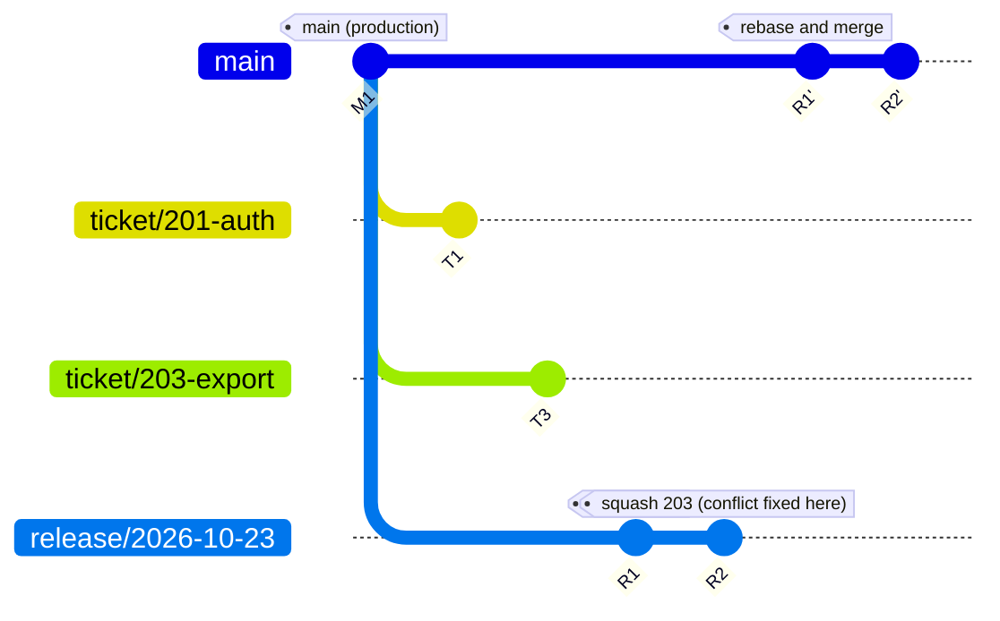

# Strategy: selective promotion

Best for client projects with scheduled or partial releases.

## When to use

- Every ticket must live on its own branch.
- Code must be integrated into a UAT environment for testing.
- The client may approve only some of the tickets that reached UAT.
- Final PRs or MRs must land on `main`.

## Core idea

Ticket branches stay isolated. They are merged into `uat` for testing. At release time the person in charge (PIC) cuts a fresh `release/*` branch from `main`. Each approved ticket gets its own PR into that branch and is squash merged. Then one PR from the release branch lands on `main` using **Rebase and merge**.

Result: N approved tickets become exactly N clean commits on `main`, with no merge commit, and the final integration is still a PR that lands on `main`.

## Branches

| Branch | Lifetime | Purpose |
|--------|----------|---------|
| `main` | Permanent | Production |
| `uat` | Permanent, reset after each release | Shared test environment. Disposable, never lands on `main` |
| `ticket/<id>-desc` | Days, until the release decision | One per ticket, branched from `main` |
| `release/YYYY-MM-DD` | One release | Temporary integration branch, cut from `main` |

## Workflow

### During development (agent)

1. Create a worktree and ticket branch from `main`.
2. The agent works in isolation.
3. When ready, merge the ticket into `uat` with a plain merge. `uat` is disposable, so merge commits there do not matter.
4. The client tests on UAT.

### At release time (PIC)

1. The client picks the approved tickets.
2. Cut the release branch from the latest `main`, not from `uat`. This keeps rejected tickets out entirely.

   ```bash
   git fetch origin
   git switch -c release/2026-10-23 origin/main
   git push -u origin release/2026-10-23
   ```

3. For each approved ticket, open a PR into `release/*` and **squash merge** it. Order tickets sensibly: least conflicting first, or by dependency.
4. If tickets conflict, resolve it in the PR into the release branch. See below.
5. Run CI and a quick UAT check on the release branch. It is the first place the combined, resolved code exists.
6. Open **one PR from `release/*` to `main`** and merge it with **Rebase and merge**.
7. Delete the release branch and the shipped ticket branches, and remove their worktrees.
8. Reset `uat` to `main` so rejected tickets do not accumulate:

   ```bash
   git switch uat && git reset --hard origin/main
   git push --force-with-lease origin uat
   ```

Rejected tickets keep their branches and can ship in a later release.

## Handling conflicts between tickets

Tickets that edit the same lines conflict. Where the conflict is resolved matters.

- **Not in the ticket branches.** If two features touch the same line, each fix would need the other ticket's code. Merging one ticket into the other also ties them together: if one is rejected, the other carries its code to production.
- **Not in `uat`.** `uat` is disposable. A fix made there is not a release.
- **Not on `main`.** A conflict fixed by hand on `main` risks human mistakes, and the result is code that was never tested the way `uat` was.
- **In the PR into the release branch.** Once the first ticket is on the release branch, rebase the second ticket onto `release/*` and fix the line once. CI tests the fix on the PR, and `main` is untouched.

```bash
git switch ticket/203-export
git rebase origin/release/2026-10-23
# CONFLICT: fix the file, then
git add <file> && git rebase --continue
git push --force-with-lease
```

Rebase, do not merge the release branch into the ticket. Merging brings back the mistake described in [principles.md](principles.md#5-keep-a-branch-current-by-rebasing-never-by-merging-the-base-in).

If only one of two conflicting tickets is approved, there is no conflict to fix. Conflicts only matter between tickets that ship together.

## Merge methods

| PR | Method | Reason |
|----|--------|--------|
| ticket → `uat` | Plain merge | Disposable branch |
| ticket → `release/*` | Squash and merge | Collapses messy agent commits into one |
| `release/*` → `main` | Rebase and merge | Appends each ticket commit as it is, with no merge commit |

- Do **not** squash the final PR. It would collapse all ticket commits into one.
- The host creates new commits when it rebases, so they get new hashes. The release branch is finished after the merge. Delete it and never reuse it.
- If `main` moved during the release, rebase the release branch onto `main` first.
- Branch rulesets can restrict which merge methods are allowed per target branch, so this can be enforced instead of remembered. Check your Git host's current settings.

## Why not separate PRs from tickets straight to `main`

- Conflicts are resolved sequentially on the production branch, one PR at a time.
- Each later PR must be rebased onto the result of the earlier one.
- Fixes are made by hand and were never tested on `uat`, so what lands on `main` can differ from what the client approved.
- The order is fixed by merge timing instead of chosen on a staging branch.



(`uat` is omitted for clarity. R1' and R2' are the same changes as R1 and R2, re-created on `main` with new hashes.)
