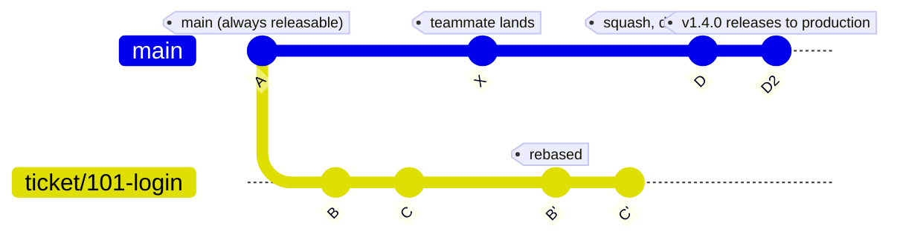

# Strategy: trunk-based development

Best for internal products and services that deploy several times a day, and for teams that want maximum speed and minimal ceremony.

## Core idea

- One long-lived branch: `main`. It must always be releasable.
- `main` deploys automatically to the staging/UAT environment. It is the only environment branch.
- Production is released by pushing a version tag (for example `v1.4.0`) on a `main` commit. The tag triggers the production deploy.
- Every ticket lives on a short-lived branch and lands on `main` within hours, or 1–2 days at most.
- Unfinished features are hidden behind feature flags.
- No long-lived `develop`, `uat` or `production` branch.

## Rules

- Always branch from the latest `main`.
- One worktree and one short-lived branch per ticket.
- Rebase onto `main` before opening the PR. Do not merge `main` into the branch.
- Squash merge into `main`.
- Every merge to `main` deploys to staging/UAT. Test and accept there.
- Release to production by tagging the tested `main` commit with an annotated tag `vMAJOR.MINOR.PATCH`. Only tags trigger production deploys.
- Tag only commits that already passed on staging/UAT. Never tag a branch other than `main`.
- Roll back by redeploying the previous tag. To fix forward, merge the fix to `main` and cut a new tag. Never move or delete a pushed tag.
- Never commit to a ticket branch after its PR has merged. Start a new branch from `main`.

## Workflow

1. Create the worktree and branch:

   ```bash
   git worktree add -b ticket/101-login ../worktrees/101 origin/main
   ```

2. The agent works only inside its own worktree.
3. Before the PR, rebase onto the latest `main` and resolve any conflict there:

   ```bash
   git fetch origin
   git rebase origin/main
   git push --force-with-lease -u origin ticket/101-login
   ```

4. Open the PR to `main`. CI and review run on it.
5. Squash merge. Because the branch already sits on top of current `main` and the conflict was settled in step 3, the squash applies cleanly.
6. Delete the branch and remove the worktree.
7. `main` deploys to staging/UAT automatically. Once the result is accepted there, tag the commit to release to production:

   ```bash
   git switch main && git pull --ff-only
   git tag -a v1.4.0 -m "Release 1.4.0"
   git push origin v1.4.0
   ```

   CI sees the tag and deploys that exact commit to production.



(The diagram draws D as one commit, and D2 stands for tagging D; a tag adds no commit. In reality B' and C' are squashed into it and the ticket branch is then deleted.)

## Environments

| Environment | Trigger | Source |
|-------------|---------|--------|
| Staging/UAT | Every merge to `main` | Latest `main` |
| Production | Push of a `v*` tag | The tagged `main` commit |

Protect `v*` tags with a ruleset so only release owners can create them. Use feature flags when `main` holds work that must not reach production yet.

## Why conflict risk is low

Branches live for hours, so the rebase is usually trivial. Several agents can run at once, each in its own worktree, and each ticket lands when it is ready. `main` stays a straight line with one commit per ticket.
