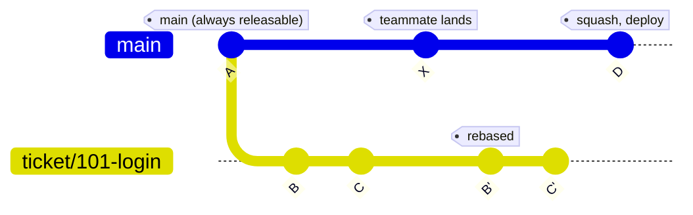

# Strategy: trunk-based development

Best for internal products and services that deploy several times a day, and for teams that want maximum speed and minimal ceremony.

## Core idea

- One long-lived branch: `main`. It must always be releasable.
- Every ticket lives on a short-lived branch and lands on `main` within hours, or 1–2 days at most.
- Unfinished features are hidden behind feature flags.
- No long-lived `develop` or `uat` branch.

## Rules

- Always branch from the latest `main`.
- One worktree and one short-lived branch per ticket.
- Rebase onto `main` before opening the PR. Do not merge `main` into the branch.
- Squash merge into `main`.
- Deploy directly from `main`, or from tags on `main`.
- Never commit to a ticket branch after its PR has merged. Start a new branch from `main`.

## Workflow

1. Create the worktree and branch:

   ```bash
   git worktree add -b ticket/101-login ../worktrees/101 origin/main
   ```

2. The agent works only inside its own worktree.
3. Before the PR, rebase onto the latest `main` and resolve any conflict there:

   ```bash
   git fetch origin
   git rebase origin/main
   git push --force-with-lease -u origin ticket/101-login
   ```

4. Open the PR to `main`. CI and review run on it.
5. Squash merge. Because the branch already sits on top of current `main` and the conflict was settled in step 3, the squash applies cleanly.
6. Delete the branch and remove the worktree.



(The diagram draws D as one commit. In reality B' and C' are squashed into it and the ticket branch is then deleted.)

## Why conflict risk is low

Branches live for hours, so the rebase is usually trivial. Several agents can run at once, each in its own worktree, and each ticket lands when it is ready. `main` stays a straight line with one commit per ticket.
